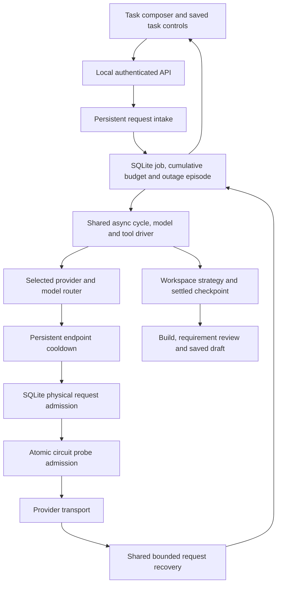

# Forge Agent outage redesign

Implemented in the source workspace on October 3–4, 2026. This change addresses
request amplification, lost recovery state, and the runtime allocation that
could leave a generated draft without time for verification.

## Execution architecture

Python owns execution and recovery. The TypeScript harness continues to project
events. `AsyncAgentEngine` supplies both runtime strategies with turn iteration,
async model requests, attempt settlement, and ordered tool scheduling. The
strategies retain their existing workspace, verification, repair, and rollback
rules. Compatibility planners run through a thread bridge; production router
planners are awaited directly. Summary callbacks cross back to the owning event
loop. `RequestExecutionContext` carries budgets, diagnostics, deadlines, and
callbacks without putting host objects into model metadata.

## Request and outage policy

| Boundary | Implemented behavior |
| --- | --- |
| Physical attempts | At most four per logical agent turn, including structured output repair. Provider adapters do not own a second agent retry loop. |
| Admission | NVIDIA capacity is one per endpoint identity across processes sharing the settings directory. FIFO tickets, renewable leases, cancellation cleanup and ownership loss fencing are persisted in SQLite. |
| Circuit | Opens after two transient physical failures, or immediately for a transient failure with a positive `Retry-After`. Original HTTP status and error remain visible. |
| Cooldown probe | Only one persisted probe is admitted after cooldown. An expired probe cannot settle a newer probe. Cooldowns survive backend restart. |
| Short retries | Release endpoint slots before sleeping. Decline a retry if its wait plus 15 seconds cannot fit the turn deadline. Long waits pass to the job scheduler. |
| Executable streams | Buffer a complete bounded attempt before releasing events; interrupted streams cannot expose executable tool fragments twice. Compatibility text streams never replay already visible text. |
| Durable recovery | 30, 60, then 120 seconds for unavailable endpoints, timeouts and network failures, with positive jitter; longer server hints are honored. At most three automatic cycles in a persisted ten-minute outage episode. |
| Scheduler ownership | Due recovery is claimed transactionally. User pauses, trust, uncertain effects, task budgets and checkpoint validity still gate continuation. |
| Model selection | Retry the chosen endpoint or explicitly continue with another configured model. No automatic provider change. Resume fingerprints include selection and checkpoint. |

Endpoint identity hashes provider, model, base URL and credential identity; the
SQLite coordination stores do not contain prompts or API keys. Two installations
using different settings directories do not share admission capacity.

## Time and accounting

The generation phase leaves a build allocation of 120 seconds by default,
bounded at 300 seconds using the p95 of up to twenty recent saved build durations,
and a 60-second requirement review allocation. The active parent deadline leaves
five seconds for persistence. Build calls have a phase deadline, and reviewers
can consume their reserved time instead of inheriting the generation reserve.
All phase allocations remain bounded by the remaining active task time.

Every dispatched model attempt reserves its input, request, and maximum response
allowances through the existing persistent budget. Intake interpretation now
has a durable identity and reservations before execution starts. A transient
intake failure is visible in the conversation. Explicit retries reuse its
accounting; clarification preserves its identity and validated interpretation.
The eventual job inherits the intake charges exactly once.

Active work and short request backoffs consume active runtime. Durable outage
cooldowns, including time spent with the app closed, have a separate persisted
counter. Restart and model switching preserve cumulative task consumption.
A manual retry starts a fresh outage episode while preserving the task budget
and still passing the endpoint circuit gate.

## Contracts and user controls

`backend/contracts/recovery.py` is the source for the generated recovery and
endpoint health contracts in `frontend/types/engine-contracts.ts` and
`docs/engine-contracts.schema.json`.

`POST /agent-runtime/jobs/{job_id}/resume` accepts an optional explicit
`provider_id` / `model_id` pair and checkpoint identity. The saved task panel
shows selection, recovery cycles, outage deadline, diagnostics, remaining
budget, and durable waiting time. It offers retry, explicit selection, saved
work inspection, local draft verification, pause, trust, and budget controls.
Legacy runs keep their existing recovery path.

Client idempotency keys include a bounded hash of an explicit model selection.
Retrying the same choice remains idempotent; choosing a different model after a
rejected attempt does not reuse that attempt's key or reset the task budget.

`GET /models/providers/{provider_id}/endpoint-health?model_id=...` reports local
circuit observations without dispatching a model request. Local `/health`
readiness is separate from provider availability; a closed circuit is not a
live availability guarantee.

## Migration and rollback

Job payloads upgrade to schema version two in the existing SQLite database.
Version-one paused jobs derive a fixed outage deadline from their saved timestamp
and retain all prior consumption. The database location and legacy checkpoints
remain compatible. No data reset is required.

`FORGEX_ENABLE_SHARED_AGENT_ENGINE=0` selects the compatibility planner bridge
and makes migrated and newly created jobs use manual recovery. Set the flag
before backend startup. Restoring it to `1` does not silently opt existing
manual jobs back into automatic recovery. `FORGEX_ENABLE_REQUEST_RECOVERY=0`
continues to disable short request retries without removing circuit protection.

## Verification and release evidence

Deterministic transport and SQLite tests exercise 503, numeric and HTTP-date
`Retry-After`, complete and streamed requests, actual reservation counts,
admission release during backoff, separate-process capacity, stale probe
settlement, reviewer allocation, restart deadlines, claim races, cycle limits,
and cumulative intake accounting. API tests exercise interpretation failure
through clarification into a job and an idempotent configured model switch with
its original budget and checkpoint. Browser fixtures exercise the saved job
panel and explicit switch without submitting another task.

Verification on October 4:

| Check | Result |
| --- | --- |
| Full Python regression suite | 2,176 passed, four Windows symlink skips; two dependency deprecation warnings. |
| Compatibility engine flag disabled | 73 passed, one Windows symlink skip. |
| UI state tests | 76 passed. |
| Conversation browser suite | 35 passed; four affected recovery cases passed again after the final selection-key change. |
| TypeScript and frontend lint | Passed; lint enforced zero warnings. |
| Optimized frontend build | Passed. |

The full-run and browser output are saved under `test-results/outage-redesign-*`.
Browser checks used the repository's transport fixtures and Edge. The browser
runner was separated from Next.js after its managed-server teardown hung;
PowerShell also reports Node color warnings as native stderr records.

Live NVIDIA
qualification, packaged desktop recovery, clean-machine installation, and
hardware sign-off remain release evidence gates. Local fault injection verifies
Forge behavior; it does not certify external endpoint uptime or device behavior.

## Missing workspace startup follow-up (October 4)

The desktop startup log exposed a saved run whose external project folder no
longer existed. Checkpoint retention tried that path twice and printed a
`FileNotFoundError` stack trace even though the backend became healthy.

Recovery now distinguishes `AGENT_RESUME_WORKSPACE_UNAVAILABLE` from an
unavailable checkpoint stage. Startup records a concise, idempotent diagnostic
and blocks the current job's automatic recovery without advancing its budget or
deleting its sealed files. Direct retries and job resumes reject the missing
workspace before reserving a replacement run. The saved task panel explains how
to restore the folder and disables continuation. Restoring the original folder
unchanged still passes the existing source and checkpoint integrity checks;
continuation remains an explicit action.

Verification: 152 orchestrator/job/API tests and 23 recovery/continuation tests
passed (overlapping sets), plus four affected browser cases. The new cases cover
cancelled, interrupted and provider-paused runs across repeated restarts,
preserved budgets and seals, no replacement or provider dispatch while missing,
and successful checkpoint continuation after restoring the original directory.
Output is saved under `test-results/missing-workspace-recovery-*`.
