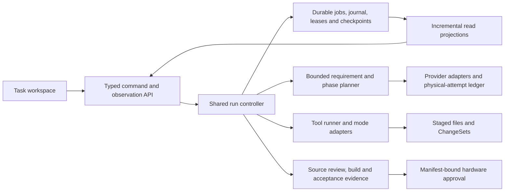

# ForgeX: application review and redesign plan

Review date: 4 October 2026. Reviewed checkout: `D:\projects\ForgeX-Phase6-Final`, including the existing uncommitted changes. Primary user complaint: the agent stops or times out.

The app needs a reliability redesign across execution, recovery, client state, and verification. The newest incident contains a real stalled provider stream, but application defects hide the evidence and make recovery harder to understand. A visual redesign should build on corrected execution contracts; changing the screens alone will leave the main complaint unresolved.

## What was verified

I traced the current failure paths through provider transport, request retries, planner deadlines, the two execution adapters, durable jobs, recovery permissions, checkpoints, projections, API streams, renderer polling, and build presentation. I also inspected desktop startup and process ownership, settings/credential persistence, staged changes, build/hardware boundaries, release scripts, existing incident reports, and the running desktop interface.

The source inventory below includes colocated tests. It excludes dependencies, generated output, bundled frontend vendor/public assets, and documentation. Inventorying a file is not equivalent to reviewing every line manually. The deepest line-level inspection covered execution and recovery, where the reported failures occur. This report is a broad application audit with reproducible findings, not a claim that every one of the 126,735 indexed lines has been manually certified.

| Area | Files | Lines | Review coverage |
| --- | ---: | ---: | --- |
| Backend | 217 | 68,287 | Deep execution/recovery/transport review; sampled supporting services and boundaries; complete available Python suite |
| Frontend | 137 | 19,942 | Deep agent hooks/API/build views; interface walkthrough; frontend and browser checks |
| Electron | 21 | 3,274 | Startup, ownership, identity, renderer/backend recovery, packaging boundaries; Electron suite |
| TypeScript harness | 12 | 1,185 | Ownership boundary, event/idempotency design; harness suite |
| Scripts | 38 | 3,604 | Verification/release/qualification paths; release-script suite |
| Python tests | 125 | 30,443 | Collection and complete suite, run in two batches |

The tree already contains substantial reliability work. I preserved that work and made no application logic changes. Review artifacts, isolated probes, and screenshots are in [review-evidence-2026-10-04](D:/projects/ForgeX-Phase6-Final/docs/review-evidence-2026-10-04/inventory.json).

| Check performed during this review | Result |
| --- | --- |
| Python tests | 2,200 passed; 4 skipped because directory symlinks were unavailable on this Windows host |
| UI state tests | 77 passed |
| Electron tests | 41 passed |
| Harness tests | 11 passed |
| Release-script tests | 35 passed |
| Browser tests | All 48 passed against the isolated development frontend |
| Frontend type checking | Passed |
| Frontend lint | Passed, with zero warnings |
| Production frontend build | Passed using a separate review build directory |
| Controlled diagnostic/deadline/recovery probes | Reproduced the behavior described in F1–F3 |
| Native desktop walkthrough | Five captured and inspected screens, using temporary application state |

Python verification here used the installed **3.10.6** environment. The README targets **3.13.15** for release builds. This result does not qualify the bundled release runtime. Browser fixtures mock API responses and EventSource; they verify UI behavior without proving the actual provider-to-database-to-renderer chain.

No paid provider task, firmware upload, physical ESP32 test, signed installer test, or clean-machine installation was performed. The isolated desktop did not resume the user's saved jobs. Historical source and installed-profile databases were opened in SQLite read-only mode.

## The newest failure, reconstructed

Source run: `agent-run-5fb8fa53ab0c40fe8ec1097e994637c7`. Job: `job-bf635b714c784bc7a4144484ff2e366c`. Provider/model: NVIDIA NIM / `nvidia/nemotron-3-super-120b-a12b`.

| Event | Evidence |
| --- | --- |
| Task started | 10:58:22 IST on 4 October |
| Third physical request started | 10:58:45 IST |
| Provider accepted the request | HTTP 200; response headers after 592 ms |
| Meaningful stream output began | 2,311 ms after request start |
| Last meaningful event | 2,390 ms after request start; six meaningful events total |
| Transport stopped waiting | 62,390 ms; `timeout_stage=stream_idle`; no completion marker received |
| Settled run state | `paused_model_unavailable`, `PROVIDER_TIMEOUT` |
| Preserved draft | Configuration present; firmware source and documentation missing; build and source review unverified |
| Active runtime consumed | About 86 of 2,700 seconds; three of 360 model requests |
| Later job blocker | `AGENT_OUTAGE_WINDOW_EXHAUSTED`, with zero automatic recovery cycles |
| Saved run diagnostics | HTTP 200 survives; attempt ID, stream timing, event count, completion, duration, and timeout stage do not |

The immediate failure was **60 seconds of silence after the provider had started responding**. HTTP 200 establishes request acceptance, not a completed generation. The evidence does not establish why the remote service stopped producing output; upstream model failure, endpoint behavior, and a stream interruption remain possibilities.

The app's task budget was not exhausted in this incident. Its automatic outage window is a separate limit. Zero cycles and an expired outage window show that automatic recovery did not execute a replacement attempt; the recorded evidence does not establish the exact gating reason for this particular job. F3 reproduces one current gate that can produce this experience.

Safe, selected evidence is saved in [latest-failure.json](D:/projects/ForgeX-Phase6-Final/docs/review-evidence-2026-10-04/latest-failure.json). This export omits task prompts, source contents, and credentials.

Historical source state contained 64 runs: 45 failed, 13 paused for a model, five completed, and one cancelled. Installed-profile history contained ten older runs. These include development and incident sessions and must not be treated as a production failure-rate sample. They show several failure families: provider stalls/unavailability, invalid plans, turn/no-progress limits, build/toolchain problems, interruption, and model allowance exhaustion.

## Findings that need repair

Priority P1 means directly affects the reported failure or can mislead users about a meaningful result. P2 means an important design or scalability weakness. “Confirmed” below means verified from current code and, where stated, a controlled reproduction. “Risk” means the problematic design exists, but its production impact has not been measured here.

### F1 — P1: a shared filter removes the timeout evidence

**Confirmed bug, reproduced.** [_safe_provider_diagnostics](D:/projects/ForgeX-Phase6-Final/backend/agent_runtime/tool_runtime.py:1412) maintains a whitelist that omits the new transport fields. Both execution adapters use this helper. Downstream orchestrator code can preserve these fields only if the helper delivers them.

The isolated probe supplied HTTP 200 plus attempt ID, headers received, first/last event timing, six events, completion false, idle-timeout stage, and duration. The helper returned only `{"http_status": 200}`. The latest saved run shows the same loss even though its raw transport log contains the full evidence.

The current tests in [test_recovery_actions.py](D:/projects/ForgeX-Phase6-Final/tests/unit/test_recovery_actions.py:18) inject already-complete diagnostics into a fake executor result. Those tests bypass this filter. This explains how persistence tests pass while the actual runtime loses the fields.

**Repair:** define one typed, redacted diagnostic contract shared by transport, planner, both execution adapters, persistence, API, and frontend. Remove competing handwritten field lists. Add a real adapter-path integration test that follows an idle timeout through restart and the UI.

**Acceptance:** an HTTP-200 idle stall persists and displays its physical attempt ID, first/last progress, event count, deadline stage, duration, completion state, and failure origin. The export remains free of secrets and partial tool arguments.

### F2 — P1: local turn expiry is classified as a provider transport failure

**Confirmed bug, reproduced.** [_bounded_turn](D:/projects/ForgeX-Phase6-Final/backend/agent_runtime/router_planner.py:221) wraps the whole turn in `asyncio.wait_for`. When its own allowance expires before the parent job deadline, [the exception handler](D:/projects/ForgeX-Phase6-Final/backend/agent_runtime/router_planner.py:262) records `timeout_stage=turn_deadline` but sets `last_failure_origin=provider_transport` and raises `PROVIDER_TIMEOUT`.

The probe expired a local turn without making any provider request. The result was `PROVIDER_TIMEOUT`, origin `provider_transport`, and `request_reached_provider=false`. This can steer the run into outage handling when the host's local turn allowance is the actual boundary.

**Repair:** distinguish local turn/phase expiry, overall job expiry, connection failure, first-event silence, stream idle, and physical attempt total. Preserve the original failure plus a separate recovery decision. A retry should not overwrite the first cause.

**Acceptance:** a local turn limit becomes a local execution-limit result with the remaining job allowance and an appropriate continuation action. It does not claim a provider outage or increment provider-outage statistics. Actual provider idle failures remain provider failures.

### F3 — P1/P2: automatic recovery and manual generation apply different permissions

**Confirmed behavior; product-policy inconsistency.** [recover_jobs](D:/projects/ForgeX-Phase6-Final/backend/agent_runtime/orchestrator.py:735) requires project build trust before any automatic continuation. [_recovery_action_info](D:/projects/ForgeX-Phase6-Final/backend/agent_runtime/orchestrator.py:568) correctly allows generation without build trust and requires trust for local verification.

In the controlled configuration-only timeout, manual `continue_generation` was allowed, local verification required trust, and automatic recovery stopped with `AGENT_PROJECT_TRUST_REQUIRED` at zero cycles. This is a concrete reason that “auto recovery” can appear to do nothing while substantial task budget remains.

After permission was granted, [project_trust_changed](D:/projects/ForgeX-Phase6-Final/backend/agent_runtime/orchestrator.py:755) cleared the blocker but scheduled no retry and started no replacement. Its docstring explicitly says it refreshes eligibility without starting work. Treat that as an intentional current behavior requiring clearer product design, rather than silently changing trust into permission to execute.

**Redesign:** make recovery eligibility depend on the next operation. Generation may continue under its existing authorization; builds stop at the local-execution permission boundary. Define automatic-recovery policy explicitly and persist its scope. Keep granting build trust separate from starting work; offer **Grant permission and resume** when both are intended. If work is eligible but no retry is scheduled, show **Ready to resume**, not a waiting/retrying state.

**Acceptance:** an untrusted configuration-only draft can resume authorized generation; it stops before a local build. User pause, exhausted budgets, changed workspaces, unknown effects, and hardware approvals remain hard boundaries. Permission changes never silently reset outage windows or restart user-paused work.

### F4 — P1: renderer requests can remain pending indefinitely

**Confirmed design defect; permanent-hang scenario not injected into the live app.** The shared [request wrapper](D:/projects/ForgeX-Phase6-Final/frontend/lib/api.ts:61) has no application deadline or default cancellation signal. [SingleFlight](D:/projects/ForgeX-Phase6-Final/frontend/lib/single-flight.ts:5) retains a read until its promise settles. The [job observer](D:/projects/ForgeX-Phase6-Final/frontend/hooks/use-forge-agent-session.ts:531) schedules its next poll only in `finally`.

If a backend/proxy connection stalls instead of rejecting, the observer cannot reach its backoff logic. Coalesced reads keep returning the same pending promise. Settings writes can also block their serialized queue behind a pending request. A fresh spinner or stale task can persist even if the backend eventually needs attention.

**Repair:** bounded read requests covering response bodies; abort on selection changes/unmount; bounded observer backoff; last-confirmed-update timestamps; a visible stale/offline state. Long operations should return an accepted operation ID and be observed separately. A timed-out mutation must be reconciled by idempotency/operation ID before any repeat submission.

**Acceptance:** a black-holed read settles within a configured client deadline; the UI reports stale information and recovers on reconnect. A late response cannot replace a newer project/task. Mutation timeouts cannot duplicate a build, resume, apply, or flash.

### F5 — P1: build presentation can show the wrong result and hides failure states

**Confirmed from source.** [BuildCanvas](D:/projects/ForgeX-Phase6-Final/frontend/components/nexus/work-canvases.tsx:89) prefers a saved agent build result over the direct build result regardless of which is newer. [selectProject](D:/projects/ForgeX-Phase6-Final/frontend/hooks/use-promptforge-workspace.ts:763) resets files and tabs but leaves the global `lastBuildResult` intact. A result can therefore outlive the project that produced it. An in-flight build also needs its response bound to the project/revision captured at dispatch.

The canvas labels any unsuccessful/no-success state `IDLE` and uses “Ready for the next build,” even when a failed build response exists. Its [memory rails](D:/projects/ForgeX-Phase6-Final/frontend/components/nexus/work-canvases.tsx:121) use hardcoded 31% Flash and 18% RAM whenever an artifact size is present. The “estimated” label does not make these values measurements.

**Repair:** a project/environment/source-revision keyed build record, with operation identity and timestamp. Display idle, running, passed, failed, unavailable, cancelled, and stale states separately. Use measured PlatformIO/toolchain memory data; render unknown when data is missing. Bind the flash action to fresh, verified manifest evidence.

**Acceptance:** after building A and selecting B, B shows no A result. A newer failed build takes precedence over an older successful agent build. Editing the relevant source/config marks prior build evidence stale. No fabricated utilization rail is displayed.

### F6 — P2: the maximum-response reservation is presented as consumed output allowance

**Confirmed policy limitation, not a budget-reset bug.** [charge_attempt](D:/projects/ForgeX-Phase6-Final/backend/model_router/run_budget.py:31) charges each physical request's maximum allowed output before dispatch. It does not settle reservations against known completed usage. Standard output allowance is 245,760 tokens, so 60 attempts reserving 4,096 tokens can consume it even with requests/time remaining.

An older installed-profile run reached exactly that output allowance with 60 requests and about 555 seconds of a 900-second runtime. The UI currently explains maximum reservations, which is better than silently reporting actual billed tokens, but the policy still stops legitimate repair work earlier than users may expect.

**Redesign:** separate outstanding reservations, verified completed usage, and unresolved attempts in a durable per-physical-attempt ledger. Keep uncertain attempts conservatively charged. Reconcile only authoritative, successfully settled usage. Choose phase-specific output caps and reserve enough model allowance for review.

**Acceptance:** known short completed replies settle their reservation once; uncertain/truncated responses remain charged; crash/retry/reviewer paths cannot refund or double-spend allowance. The UI distinguishes usage from reservations and explains which dimension prevents the next attempt.

### F7 — P2: complex projects can hit a monolithic semantic-review ceiling

**Confirmed limitation; not linked to the latest idle incident.** [review_prompt](D:/projects/ForgeX-Phase6-Final/backend/agent_runtime/verification.py:12) bundles complete referenced files and rejects encoded review context above 128,000 bytes. Review also has a bounded 60-second phase. An otherwise compiled multi-file project can fail finalization because its verification package exceeds this ceiling.

**Redesign:** bounded review units associated with requirement IDs, precise source spans, and dependency context. Aggregate a revision-bound coverage report. Reserve verification resources before generation. Never treat a smaller excerpt or a successful compile as evidence that omitted behavior is correct.

**Acceptance:** large qualified projects can be reviewed in multiple bounded units; every requirement and exclusion receives a current verdict. Any uncovered or stale item blocks completion with a useful explanation. A review-provider outage permits inspection/local checks without claiming full completion.

### F8 — P2: observation paths repeat expensive validation and projection work

**Confirmed design; performance impact is an unmeasured risk.** [recovery_info](D:/projects/ForgeX-Phase6-Final/backend/agent_runtime/orchestrator.py:526) verifies the journal and inspects workspace/stage revisions synchronously. [session_projection](D:/projects/ForgeX-Phase6-Final/backend/agent_runtime/orchestrator.py:865) snapshots and rebuilds the full history, then saves a projection checkpoint on every call. The [run SSE loop](D:/projects/ForgeX-Phase6-Final/backend/api/routes/agent_runtime.py:1568) asks for events, transient events, and run state on a 100-ms loop; these can invoke repeated `get_run` checks. Stable runs close their stream, so this is not an indefinite paused-run loop.

This can make observation compete with execution and lease renewal as histories/projects grow. There is no benchmark here proving this caused a particular outage.

**Repair:** incremental, versioned projections; paged event reads; cached validated journal heads; bounded worker-thread filesystem inspection; shared snapshots within one API read; notification-driven stream wakeups. Revalidate workspace/journal integrity before resume/apply/flash even when display data was cached.

**Acceptance:** benchmark large history and source trees while a job is active. Read endpoints remain responsive, memory is bounded, lease renewal remains timely, and integrity changes invalidate cached eligibility. A cached view must never grant mutation authority.

### F9 — P2: backend health and configured providers look like task readiness

**Confirmed semantics/UX gap.** The [health route](D:/projects/ForgeX-Phase6-Final/backend/api/routes/health.py:21) reports service composition; planner/coordinator are always true and `engine_ready` checks installed service objects/local auth/orchestrator. PlatformIO readiness is returned separately. Neither “healthy” nor the green “Connected” header proves that the selected model can complete a task or that a project's selected environment is buildable.

In the captured startup there was no project or target, yet the header was green. Provider configuration and availability likewise need separate labels. An earlier saved run encountered a missing build tool only after model work had already been spent.

**Redesign:** a task-specific readiness summary: workspace accessible, selected provider configured, latest connectivity check with age, mode capabilities, toolchain executable/version, target environment, and required local permission. Do not make paid test generations an automatic preflight.

**Acceptance:** local build prerequisites fail before an expensive generation/build flow when the task requires them. Inspection/generation remain available when their own prerequisites pass. The interface distinguishes **App connected**, **Model configured**, **Model last checked**, and **Ready for this task**.

### F10 — P2: backend process recovery is less complete than renderer recovery

**Confirmed implementation gap; no backend-crash incident reproduced.** [renderer-recovery.ts](D:/projects/ForgeX-Phase6-Final/electron/renderer-recovery.ts:20) has a bounded crash reload circuit. The [backend exit handler](D:/projects/ForgeX-Phase6-Final/electron/backend-manager.ts:194) marks the backend crashed and clears ownership; it does not itself supervise a restart. Startup has good contract, source-fingerprint, and authentication checks.

**Redesign:** a bounded desktop backend supervisor with explicit recovery/degraded states, restart backoff, owned-process-only cleanup, and the existing identity/auth checks. Rehydrate durable jobs after restart without granting side-effect replay authority. Offer a visible manual recovery action when the circuit stops.

**Acceptance:** kill only the owned test backend during a read and during a settled generation boundary. The desktop becomes stale/recovering, restores observation after restart, and preserves user pause/budgets. Unknown apply/flash outcomes remain blocked and require inspection.

### F11 — P2: shared execution still leaves substantial mode policy duplicated

**Confirmed architecture debt.** [AsyncAgentEngine](D:/projects/ForgeX-Phase6-Final/backend/agent_runtime/engine.py:44) shares cycle/admission/scheduling seams, which is useful. [autonomous_loop.py](D:/projects/ForgeX-Phase6-Final/backend/agent_runtime/autonomous_loop.py) and [tool_runtime.py](D:/projects/ForgeX-Phase6-Final/backend/agent_runtime/tool_runtime.py) still own substantial separate execution/progress/verification behavior. The orchestrator, API facade, legacy generation service, and frontend hooks are also large.

Large files are not defects by themselves. The practical problem is policy drift across modes and boundaries, demonstrated by the diagnostic filter and recovery permissions. Rewriting the stack in a different language would add migration risk without fixing those contracts.

**Redesign:** retain Python as the authoritative executor. Move job state transitions, phase budgets, attempt settlement, diagnostics, recovery eligibility, and verification orchestration into shared services. Keep mode-specific tool/workspace behavior in adapters. Keep the TypeScript shadow harness optional.

**Acceptance:** Inspect, Plan, Review, and Auto use the same lifecycle/failure contract; strategy-specific differences are explicit. New timeout or recovery behavior has one implementation and an adapter parity test.

### F12 — P2: deliverable progress needs more precise obligations

**Confirmed limitation.** [deliverables.py](D:/projects/ForgeX-Phase6-Final/backend/agent_runtime/deliverables.py:27) infers broad obligations from text and recognized paths. Documentation presence accepts any Markdown file. The code correctly treats presence as a work hint, not proof of correctness, and keeps acceptance evidence separate. The latest draft correctly says source/documentation are missing.

**Redesign:** derive explicit deliverable obligations from the accepted task contract: required modules/files where specified, requested documentation topics, configuration/environment, and acceptance checks. Associate each obligation with current source evidence and distinguish **missing**, **present**, **reviewed**, **built**, and **device-tested**.

**Acceptance:** an unrelated existing Markdown file does not make requested new wiring/calibration instructions appear covered. A configuration-only checkpoint remains incomplete. A large request can resume at a missing obligation without redoing settled files.

### F13 — P2: documentation and release evidence need one current source of truth

**Confirmed mismatch.** [README.md](D:/projects/ForgeX-Phase6-Final/README.md:129) still describes a strict 45-second NVIDIA deadline and 60-second turn budget. Current [TransportPolicy](D:/projects/ForgeX-Phase6-Final/backend/contracts/transport.py:10) defaults are connect 10, first event 120, idle 60, physical total 300, write 30, and pool 5 seconds; parent/provider deadlines may shorten them. The generation planner normally caps a turn at 180 seconds and can shorten it further to reserve later phases.

Several earlier implementation reports describe fixes that exist in today's source. A report saying diagnostics survive restart was supported by fake executor coverage, while F1 shows an actual adapter gap. Development and installed app state also use separate locations; an old saved run is not evidence that the current source or the installed candidate contains the same code.

**Repair:** generate the runtime-support/deadline reference from contracts, show build/source identity and active data profile in diagnostics, bind qualification reports to the exact packaged artifact, and update old reports with superseded/current status. Keep a reproducible incident-to-regression ledger.

**Acceptance:** a support export identifies app/backend/frontend versions, source fingerprint, Python/toolchain versions, data profile, and relevant attempt/job IDs. Old run history is clearly distinguished from current runtime behavior.

## Existing foundations to retain

The app already has valuable safety and durability machinery. Keep its fenced session leases, sealed checkpoints, idempotent continuation reservations, staged ChangeSets, workspace conflict detection, monotonic budgets, endpoint admission/circuit breakers, credential storage outside ordinary settings JSON, process ownership, one-time hardware approvals, and manifest-bound firmware flashing.

Current code also already handles explicit stream completion markers, separate transport progress deadlines, bounded retries, saved configuration-only drafts, model-independent local verification, and following replacement runs in the UI. Earlier issues involving serialized host callbacks, path normalization, diagnostic-mode inference, and several cancellation/stream-lifecycle cases have regression coverage. They are historical failure families to retain in qualification, not automatically new current bugs.

A failed or incomplete model stream must never execute partial tool arguments. An interrupted apply/flash operation with an unknown outcome must never be blindly replayed. The redesign must preserve these invariants.

## Target architecture

Use a durable **job** as the objective, a **run** as one continuation attempt, and a **physical attempt** as one provider request. The renderer observes these identities; the backend owns execution.



A single failure envelope should carry `origin`, `category`, `timeout_stage`, `retryable`, `job_id`, `run_id`, `physical_attempt_id`, last meaningful progress, remaining allowances, current revision, and allowed actions. Store the original cause and recovery outcome separately.

The durable lifecycle should distinguish **running**, **waiting for model cooldown**, **paused by user**, **permission required**, **allowance exhausted**, **verification incomplete**, **unknown effect**, **failed without a safe continuation**, **cancelled**, and **completed**. Map compatible old statuses to the new projection without erasing their journal history. Do not rename statuses in all layers at once without an explicit schema migration.

Plan work as bounded deliverables and meaningful checkpoints: configuration, one or two complete edits, a build/repair unit, review units, and a final acceptance aggregate. Use current progress to choose useful work within the remaining phase budget. Extending every timeout should not be the primary repair.

HTTPX's read timeout measures waiting for the next data chunk; it is not a whole-task deadline. Keep the host's meaningful-event and total deadlines explicit. [HTTPX timeout documentation](https://www.python-httpx.org/advanced/timeouts/).

Python's `wait_for` cancels the awaited operation and waits for cancellation, so elapsed cleanup can exceed the nominal timeout. Cancellation and owned-process cleanup require their own bounded, tested contract. [Python asyncio documentation](https://docs.python.org/3.13/library/asyncio-task.html#asyncio.wait_for).

## Interface audit and complete product redesign

The screenshots below were captured from an isolated native desktop session during this review and the saved files were inspected. They cover setup and readiness, not a newly dispatched live provider failure. The runtime incident analysis comes from the user's saved logs/database, separately from these screenshots.

1. **Task entry:** [startup screenshot](D:/projects/ForgeX-Phase6-Final/docs/review-evidence-2026-10-04/01-startup.png). The workspace/project entry is visible, and submission correctly needs a project. The largest visual space is a marketing-style heading, while the actual prerequisites, chosen mode, and task allowance are much smaller. Bring **Open workspace** and task readiness into the main action area. Explain the disabled composer beside it.

   

2. **General settings:** [settings screenshot](D:/projects/ForgeX-Phase6-Final/docs/review-evidence-2026-10-04/02-settings.png). Categories and settings search are useful; firmware confirmation is described clearly. Two navigation columns consume substantial width. A disabled safety switch visually resembles an ordinary editable preference. Present always-required flash confirmation as an explicit policy/status row. Keep general preferences separate from task recovery permissions.

   

3. **Model setup:** [models screenshot](D:/projects/ForgeX-Phase6-Final/docs/review-evidence-2026-10-04/03-model-settings.jpg). Credentials are masked, the active model is explicit, and a test action exists. Provider setup, enabled status, provider default, active model, and execution explanation compete in one dense screen. Replace ambiguous **Ready** labels with configured/disabled/last-tested states. Keep the actual active selection prominent, and show endpoint cooldown/progress history when relevant.

   

4. **Runtime status:** [runtime screenshot](D:/projects/ForgeX-Phase6-Final/docs/review-evidence-2026-10-04/04-runtime-status.jpg). PlatformIO version/path and backend status are useful. App version alone does not identify the source changes loaded; the app data path is generic. Add a compact expandable diagnostic view with runtime identity, real data profile, last confirmed heartbeat, provider attempt, and task-specific prerequisites.

   

5. **Project entry:** [projects screenshot](D:/projects/ForgeX-Phase6-Final/docs/review-evidence-2026-10-04/05-project-entry.jpg). **Open folder** is clear and search is present. The empty state has little guidance beyond opening a folder. Add existing-project and new-project paths with a brief explanation of the required project format; preserve direct folder opening. Show missing/replaced folders as recoverable states with retained task history.

   

Across these screens, helper text and operational metadata are small and subdued. Some work-canvas source explicitly uses 9–11 px text. Named navigation, form controls, and status elements are present in the accessibility tree, which is a useful foundation. This audit did not certify contrast, focus order, screen-reader announcements, zoom/reflow, or accessibility compliance. The browser suite exercises some keyboard/narrow-screen paths, but its passing result is not a full accessibility audit.

The product redesign should use these surfaces:

| Surface | Required behavior |
| --- | --- |
| Workspace/home | Project entry, readiness summary, active/recoverable jobs, actionable last failure; compact initial task composer |
| Active task | Persistent task header, accepted requirements, current phase, last real progress, allowance summary, Pause/Stop, staged files and next action |
| Recovery panel | One primary explanation and action, then expandable details; distinguish Continue generation, Verify locally, Review uncertainty, Add allowance, and Change model |
| Files and changes | Accessible editor, unsaved-change state, isolated draft identity, full diff, conflict handling, explicit apply/revert; preserve user edits |
| Build and evidence | Project/environment/revision-bound outcome, compiler diagnostics, measured memory, artifact manifest, requirement review, test results, and separate device evidence |
| Device and serial | Enumerated device versus monitor connection, bounded reconnection, port ownership, explicit firmware approval, device identity and disconnection actions |
| Settings | Model configuration/selection/health; local execution permissions; readable appearance defaults; actual runtime identity and a safe support export |

A paused task should say, for example: **“The model stopped sending output. Your configuration was saved; firmware is still missing. Continue generation.”** Add last-progress time, model name, scheduled retry time, and remaining allowance below that. Move raw classifications and detailed counters into diagnostics. The current [AgentJobControls](D:/projects/ForgeX-Phase6-Final/frontend/components/nexus/agent-job-controls.tsx:32) contains useful information but presents many parallel paragraphs; compress it around the user's next decision.

Make status changes observable and accessible: persistent text as well as color, labelled controls, visible focus, predictable keyboard navigation, readable default metadata, reduced-motion support, and announcements for transitions rather than every stream chunk. Measure contrast and reflow on the real packaged renderer. Keep the editor and logs usable during a provider outage.

## Implementation sequence

This is an incremental redesign with concrete reviewable changes. Stabilize the current app first, then consolidate architecture and replace the workflow screens. Each item should be its own bounded change with regression evidence.

| Order | Work package | Main code areas | Exit criteria |
| --- | --- | --- | --- |
| 0 | Preserve incident evidence and establish a candidate baseline | Review probes; test fixtures; runtime identity; qualification scripts | Redacted current incident fixtures, known source/runtime identity, baseline suite results; no user workspace mutation |
| 1 | Unify diagnostics and failure causes: F1, F2 | Transport/planner contracts, `tool_runtime`, `autonomous_loop`, orchestrator, serialization, frontend types | Actual adapter-path idle timeout survives persistence/restart; local deadline cannot masquerade as provider transport |
| 2 | Bound client observation and correct build truth: F4, F5 | `api.ts`, `single-flight`, agent/workspace hooks, BuildCanvas, settings queue | Black-holed reads recover; late responses cannot cross task/project boundaries; failed/stale build states accurate |
| 3 | Make recovery operation-specific: F3 | Jobs, orchestrator eligibility/scheduler, recovery API/actions, controls | Generation/build permission parity; visible waiting versus ready-to-resume; explicit resume after permission changes; no unsafe replay |
| 4 | Add physical-attempt accounting and bounded work units: F6, F12 | Request execution context, budget ledger, task contracts, deliverables, continuation state | Durable reserve/settle accounting; unresolved requests stay charged; resume addresses missing obligations without resetting history |
| 5 | Make verification scale with the task: F7 | Verification service, requirement report, phase budgets, build freshness | Large project reviewed in bounded units; complete current coverage required; local verification works independently of model availability |
| 6 | Consolidate the run controller and efficient read model: F8, F11 | Shared engine, mode adapters, orchestrator, stores/projections, SSE routes | Adapter lifecycle parity; incremental observations; performance targets met without weakening integrity checks |
| 7 | Redesign workspace/setup/task/recovery/build screens: F5, F9, F12 | Nexus shell/task/recovery/evidence canvases, settings, editor, design tokens | User can identify state, saved work, blocker, and next action from one screen; accessible critical flows verified |
| 8 | Supervise desktop runtime and qualify release: F10, F13 | Electron managers, runtime identity, packaging, release documentation/gates | Bounded restart recovery; packaged candidate passes real-provider, ESP32, installer and clean-machine gates |

Work packages 1–3 are the first release-worthy repair slice. They should land before the major visual replacement. Package 7 can begin with a concrete interaction specification while backend work proceeds, but its implemented status/actions must consume the corrected contracts.

Do not combine all packages into one unreviewable replacement. Use schema-versioned readers and explicit migration for new accounting/projections. Retain old journals and recovery checkpoints. Roll back a frontend/controller release by version/feature switch while preserving the durable data format; never roll back by discarding user jobs or rewriting evidence.

## Fault matrix and release acceptance

The missing tests are predominantly across boundaries. Keep the existing broad suites and add targeted tests that exercise transport → planner → real execution adapter → durable store → API → renderer, instead of injecting the final expected result at each boundary.

| Fault or scenario | Required result |
| --- | --- |
| HTTP 200 followed by no meaningful event | First-event cause recorded; bounded stop; safe draft; useful recovery action |
| HTTP 200, several events, then silence | Idle cause and last progress recorded; no partial tool execution; same evidence after restart |
| Completed stream held open by the server | Protocol completion settles promptly; no waiting for remote connection close |
| Productive stream reaches local turn cap | Local deadline classified accurately; checkpoint-safe continuation; no false endpoint-outage claim |
| HTTP 429/503 with Retry-After | Bounded short retries or durable cooldown; exact model retained; allowance charged once per physical attempt |
| Provider response contains malformed/truncated tool calls | Bounded repair; original cause retained; no writes from an incomplete attempt |
| Backend/read connection black-holed | Client settles on deadline; stale state visible; observation can recover |
| User pause/cancel during model wait, retry wait, build, and review | Future execution fenced; terminal state consistent; owned children cleaned; no late output overrides |
| Restart after a settled checkpoint | One continuation reservation; allowance/history retained; no duplicated side effects |
| Untrusted project, configuration-only draft | Generation and inspection work within authorization; build waits for explicit permission/source |
| Trust granted after retry timer settled | UI accurately shows whether a retry is scheduled; explicit resume is available; no surprise execution |
| Missing/changed workspace or discarded draft | Safe block with a specific recovery path; no applying old evidence to a new workspace |
| Unknown apply or flash outcome | Inspection required; no automatic repeat operation |
| Short completed replies versus uncertain output | Verified reservations settle once; uncertainty retains charge; reviewer shares allowance |
| Large multi-file project | Bounded generation/review units; full requirement coverage; no false final success |
| Project switched during a build | Response stays attached to dispatched project/environment/revision |
| Manual source/config edit after successful build | Evidence becomes stale; flash cannot use invalidated manifest |
| Backend/renderer crash | Bounded recovery, visible degraded state, jobs retained, ownership/identity checks preserved |
| Device unplug/re-enumeration/port contention | Finite retry, clear connection state, identity-bound approval, no competing monitor/flash owner |

Recommended measurable release goals, to be validated rather than assumed:

- Zero partial tool execution, duplicate apply/flash, or allowance reset across deterministic restart/cancellation tests.
- Every terminal or paused attempt has a structured cause, a saved-work summary, and an allowed next action or a clear reason no safe continuation exists.
- Observation freshness is explicit; a pending read cannot hold the UI indefinitely.
- Demonstrate responsive health/job observation and timely lease renewal with large histories and projects; set numerical latency targets after collecting a baseline.
- Replay the existing real-provider qualification fixtures, including long specifications and follow-up edits, against the exact packaged candidate. Include NVIDIA idle-stall behavior and the selected alternative provider's response contracts.
- Validate ESP32 build/artifact/hash approval, physical upload and serial behavior, signing, and clean Windows installation using the existing release gates. Unqualified targets remain labelled as such.

External provider availability cannot be guaranteed by an app redesign. The release promise should be **bounded failures, preserved settled work, truthful diagnostics, and safe continuation**, with measured completion reliability on qualified tasks/providers.

## Evidence and reproducibility

- [Probe source](D:/projects/ForgeX-Phase6-Final/docs/review-evidence-2026-10-04/audit_probes.py) and [probe results](D:/projects/ForgeX-Phase6-Final/docs/review-evidence-2026-10-04/probe-results.json): diagnostic loss, local deadline misclassification, and operation-permission recovery behavior.
- [Read-only extraction source](D:/projects/ForgeX-Phase6-Final/docs/review-evidence-2026-10-04/extract_evidence.py), [latest incident](D:/projects/ForgeX-Phase6-Final/docs/review-evidence-2026-10-04/latest-failure.json), and [inventory](D:/projects/ForgeX-Phase6-Final/docs/review-evidence-2026-10-04/inventory.json).
- [Verification results](D:/projects/ForgeX-Phase6-Final/docs/review-evidence-2026-10-04/verification-results.json): commands, suite counts, environment, and verification limits.
- Completed raw check logs are retained in `docs/review-evidence-2026-10-04/verification-logs`, including the [remaining Python suite](D:/projects/ForgeX-Phase6-Final/docs/review-evidence-2026-10-04/verification-logs/python-rest.log), [job tests](D:/projects/ForgeX-Phase6-Final/docs/review-evidence-2026-10-04/verification-logs/jobs.log), and [48 browser scenarios](D:/projects/ForgeX-Phase6-Final/docs/review-evidence-2026-10-04/verification-logs/browser.log).
- Screenshots 01–05 embedded above: accepted captures from the current isolated desktop walkthrough. Original screenshot bytes were saved and inspected; no generated mockups were used as audit evidence.

Rerun isolated probes from the repository root:

```powershell
.venv\Scripts\python.exe docs\review-evidence-2026-10-04\audit_probes.py
.venv\Scripts\python.exe docs\review-evidence-2026-10-04\extract_evidence.py
```

The extraction script targets the recorded incident ID. If that history is unavailable in another checkout/profile, use the saved redacted JSON instead. Probe runtimes use temporary state and fake providers; they do not invoke the user's live model or hardware.
