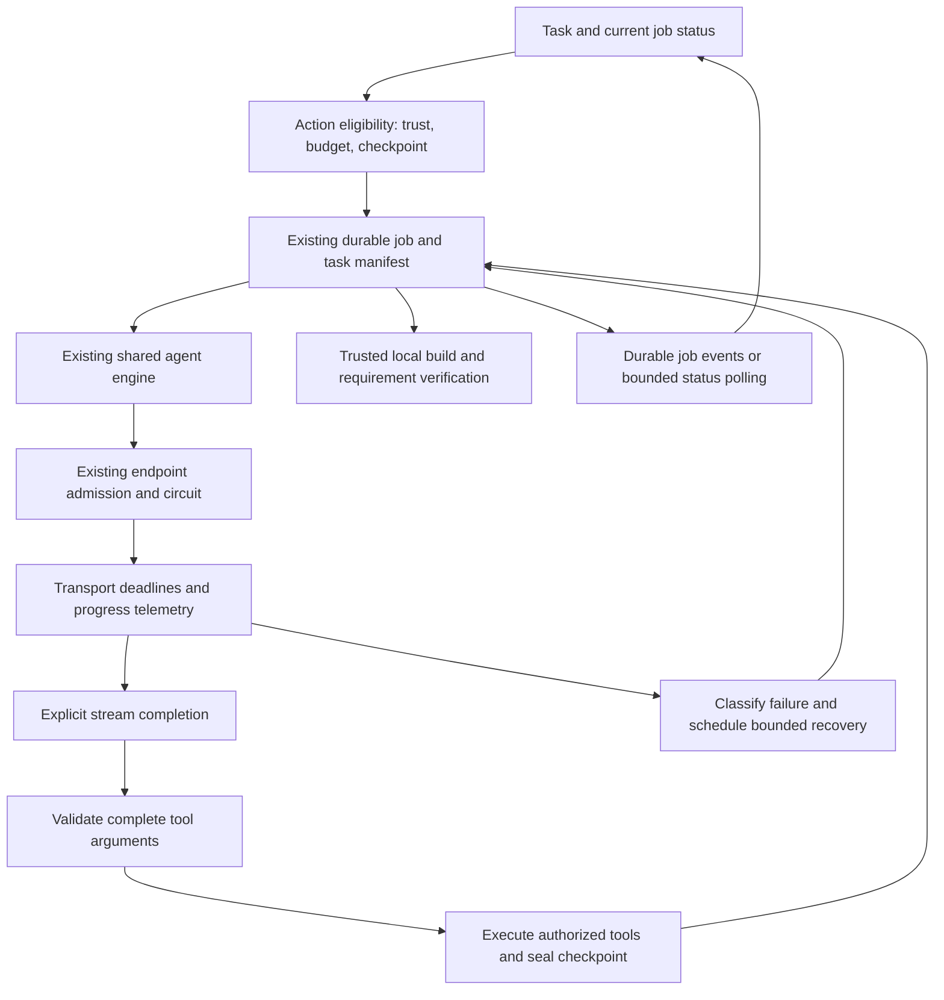

**ForgeX provider timeout review and permanent fix plan — October 4, 2026**

This is a review and implementation plan. Application code, project trust, the
live task, its budget, and its checkpoint were not changed during this review.

The recommended change extends the existing shared engine, durable jobs,
endpoint admission, circuit breaker, and sealed checkpoints. Those mechanisms
already preserve work. The remaining work is correct stream completion,
progress-aware deadlines, action-specific recovery eligibility, and accurate
task progress. External service availability cannot be guaranteed by desktop
code; ForgeX can guarantee bounded handling and preservation of settled work.

**Evidence from the actual run**

Run: `agent-run-96419fcac8c046bf8bbe815a964cae20`.
Job: `job-234c7aed8a61481f8264d006dd192f8f`.
Provider/model: `nvidia_nim` / `nvidia/nemotron-3-super-120b-a12b`.

The live backend and desktop logs and the SQLite state were read directly. The
database was opened with `mode=ro`; no agent or provider request was dispatched.

| Observation | Meaning |
| --- | --- |
| Turns 1 and 2 completed in about 9.9 and 11.4 seconds. | The selected endpoint worked for the first two turns. |
| Turn 3 used two physical attempts, each reaching the 120-second limit; the logical request took 242.4 seconds. | Short retry consumed another full timeout before durable recovery. |
| The failure was `PROVIDER_TIMEOUT`; no 503 was recorded for this incident. | Timeout handling needs investigation independently of HTTP 503 handling. |
| The sealed turn-2 checkpoint contains only `platformio.ini`. | Source files, documentation, tests, and a successful build remain outstanding. |
| The job is blocked by `AGENT_PROJECT_TRUST_REQUIRED`, with zero automatic recovery cycles used. | Automatic recovery did not dispatch another request because project trust was missing. |
| The renderer recorded `AGENT_PROJECT_TRUST_REQUIRED` in the 409 Verify Draft response. | The verification rejection is a local permission check, separate from the provider timeout. |
| The job consumed about 267 of 2,700 active seconds and 4 of 360 model requests. | This incident did not exhaust the job budget. |

Sources: `.forgex/logs/live-runtime.backend-590ae4f0612a4698b669c1cb3d0ae135.jsonl`,
`.forgex/logs/live-runtime.desktop-1dc5e148-a751-4d91-bbcc-33899d2cf1c4.jsonl`,
and `.promptforge/state/agent-orchestration.sqlite3`.

**Confirmed defects and limits of the evidence**

1. `_iter_sse_json` in `backend/services/llm_service.py` yields the `[DONE]`
   sentinel and then continues reading the socket. `generate_event_stream`
   holds its terminal event until that reader ends. A server that leaves the
   connection open after `[DONE]` turns a complete response into a timeout.
   The router's transactional stream buffer then discards the attempt and can
   retry it. This defect was reproduced using an in-memory HTTPX transport.
   It is not proven to be the trigger in this live run.
2. The transport passes one timeout value both to HTTPX and to a wall-clock
   deadline covering the entire stream. Continuous, useful generation can
   therefore time out at 120 seconds. HTTPX's read timeout measures the wait
   for a data chunk, which is a different condition from total elapsed time.
3. `_timeout_error` reports the compatibility protocol name `OPENAI`, omits
   captured response metadata, and does not identify the timeout stage or
   stream progress. `request_reached_provider=false` in the saved run cannot
   establish that no response headers or stream data arrived.
4. Verify eligibility is based on generic `recovery_info`, while project trust
   is checked later by `verify_saved_draft`. The UI can offer verification
   that is certain to receive a 409. The generic rejection message obscures
   the actionable permission reason.
5. The run stream is treated as stable when the provider pauses. Later durable
   job mutations, such as the scheduler recording a trust blocker, are not
   accompanied by a recovery event at those mutation sites. Job observation
   must continue after a run pauses; otherwise the displayed recovery state
   can lag behind the authoritative SQLite job.
6. The saved task projection infers expected artifacts from filename patterns
   in the request. This prompt produced only `platformio.ini` as an expected
   artifact, and its saved next action says to verify and finish despite
   missing firmware. This is a projection/completeness gap, not evidence that
   this run was incorrectly marked successful.

The current NVIDIA adapter already supplies `enable_thinking=false`,
`force_nonempty_content=true`, `temperature=1.0`, and `top_p=0.95` for agent
turns. These settings match the relevant guidance in the
[NVIDIA model card](https://build.nvidia.com/nvidia/nemotron-3-super-120b-a12b/modelcard).
Changing those values is not the first fix supported by this incident.

**Recommended architecture**

Generation and local verification have separate eligibility. A sealed draft
remains inspectable during a provider outage. Local compilation does not depend
on a successful provider request, but it still requires project trust and enough
local build budget. A configuration-only draft must be described as incomplete.

**Implementation order and acceptance criteria**

| Priority | Change and files | Required result |
| --- | --- | --- |
| P0 | Correct terminal handling in `backend/services/llm_service.py`. | `[DONE]` ends the OpenAI-compatible reader immediately and closes the response. Preserve finish reason and usage already received; emit one terminal event. |
| P0 | Expose action eligibility in `backend/agent_runtime/orchestrator.py`, recovery contracts, API routes, and `frontend/components/nexus/agent-job-controls.tsx`. | Inspect, continue generation, and verify locally each have an allowed flag and precise reason. Verify stays unavailable while trust is missing. |
| P1 | Add a typed transport policy to `backend/model_router/models.py`, provider adapters, and the LLM service. | Connect, first meaningful event, stream inactivity, and total generation have distinct bounded deadlines, all capped by the current phase deadline. |
| P1 | Add physical-attempt progress in provider adapters/router and safe diagnostics. | Every attempt has its own identity and records headers, first event, last event, completion, timeout stage, and actual elapsed time. |
| P1 | Adjust `backend/model_router/request_recovery.py` and existing job scheduling. | Long first-event/stall timeouts enter durable cooldown rather than immediately spending another full timeout. Short transient failures retain bounded same-model retries. |
| P1 | Observe durable job changes in `jobs.py`, `orchestrator.py`, `frontend/hooks/use-forge-agent-session.ts`, and stream policy. | Paused jobs display current permission/cooldown state and follow the replacement run after automatic continuation. |
| P2 | Introduce a persisted deliverable manifest and smaller work units in task state, task contracts, and router planner. | Recovery knows which files/features remain. A single config file cannot make the next action claim the project is ready to finish. |
| P2 | Qualify the complete workflow against deterministic failure scenarios and the real selected endpoint. | A timeout followed by recovery completes the original task with preserved budgets, settled writes, and truthful verification. |

**Transport and retry policy**

Use the following as initial engineering defaults, then tune them from measured
latency. These are proposed settings, not an NVIDIA guarantee:

| Deadline | Initial proposal | Purpose |
| --- | --- | --- |
| Connection establishment | 10 seconds | Fail promptly when the endpoint cannot be reached. |
| First meaningful model event | 120 seconds for this hosted NVIDIA profile | Allow provider queue/cold-start latency while distinguishing it from generation. |
| Inactivity after meaningful progress | 60 seconds | Stop a stalled stream without killing one that continues producing useful data. |
| Total physical generation | At most 300 seconds | Bound a productive response; further cap this by the remaining turn/phase allocation. |

HTTPX supports separate connect/read/write/pool timeouts. The semantic first-event
and total deadlines still require application logic; HTTPX socket activity alone
does not prove model progress. See the
[HTTPX timeout documentation](https://www.python-httpx.org/advanced/timeouts/).

- Reset the semantic inactivity timer on meaningful text, reasoning, or tool
  argument events. Keep heartbeat/socket activity separate. Heartbeats must not
  make an otherwise silent model run forever.
- End immediately on the explicit completion marker. Do not end on the first
  `finish_reason` packet if the provider may still supply usage metadata before
  its explicit marker. Handle other protocols with their documented terminal
  signals rather than a global OpenAI-specific rule.
- Record failures as `connect`, `first_event`, `stream_idle`, `attempt_total`,
  or `job_deadline`, keeping the existing safe error code where compatibility
  requires it. Do not present an application time-budget limit as endpoint
  downtime or a received 503.
- Preserve response status/request ID if headers arrived, including HTTP 200
  followed by an incomplete stream. Report NVIDIA as the selected provider.
- Keep execution events buffered until the complete response is validated.
  Expose only safe progress counts/timing while buffering; never execute partial
  tool arguments or replay previously settled tool calls.
- For long timeout failures, seal settled work and use the existing durable
  cooldown/circuit policy. For short 502/503/network failures, permit short
  retries only when the wait and a useful response window fit the phase budget.
  Keep the cumulative attempt limit and honor `Retry-After` without shortening it.
- Retain the existing three-cycle/ten-minute outage episode and cumulative job
  budget. If the selected endpoint remains unavailable, offer explicit
  continuation with another configured model using the same task/checkpoint.

**Permission and progress behavior**

The existing trust requirement should remain enforced. Show it before the
workflow needs to build and show the exact affected action. For this task, the
message should explain that local builds require trusting the current project
folder, while saved changes remain available for inspection.

Use one server-side eligibility calculation to drive controls and validate their
API requests. Include checkpoint validity, current workspace, trust, relevant
budget dimensions, draft availability, and known missing prerequisites. Verify
should not require unused model tokens; generation should not inherit irrelevant
local-build permissions simply because both actions share a recovery method.

After a trust change, refetch the job and action eligibility. Resume through the
existing explicit continuation action, or an already opted-in safe recovery
policy when still eligible. A permission change must not silently reset an
expired outage episode or user pause. Emit durable state changes and preserve
the original provider failure alongside the current local blocker.

Keep a lightweight job observation channel while recovery is scheduled. It must
notice current-run replacement, blockers, budget changes, and cancellation even
when the old run's SSE connection has closed. Use job events with reconnection
and bounded polling as fallback; do not poll providers or dispatch health probes
just to refresh the UI.

For generation, persist planned deliverables before relying on completion:
PlatformIO configuration, firmware source, reusable conversion/alarm logic,
tests, wiring/calibration documentation, and build evidence for this request.
Combine request requirements, explicit planning, and source evidence rather than
filename regexes alone. Preserve open-ended tasks without imposing ESP32-specific
files on every project. Prefer one or two bounded source edits per turn when a
larger response risks the token/time limit; validate each complete tool call and
checkpoint its result. A timeout resumes the unfinished milestone.

**Verification required before calling the fix complete**

1. `[DONE]` with an open socket: finishes promptly, closes transport, preserves
   finish reason/usage, performs one physical request, and never retries.
2. `[DONE]` with EOF and finish-reason/usage packets: remains compatible and
   produces exactly one terminal event.
3. Productive slow stream: survives beyond the old wall-clock cap when still
   within the proposed total and parent phase deadlines.
4. Silent first event, stalled tool arguments, and heartbeat-only responses:
   classify the correct timeout stage; partial tools never execute.
5. Parent cancellation or time reserve: releases admission/response ownership
   promptly and preserves the original task budget.
6. 429/503 with short, long, and date-form `Retry-After`: obeys existing cooldown,
   claim, attempt, and circuit constraints across backend restart.
7. Untrusted project: controls explain the permission requirement, verification
   dispatches no build, and automatic recovery does not claim a permitted cycle.
8. Trust granted, backend restart, or explicit model selection: refreshes current
   eligibility and resumes the same sealed work without resetting consumption.
9. Original ESP32 prompt: the saved config-only stage is recognized as incomplete;
   recovery generates missing deliverables, runs appropriate tests/build, and
   reports compilation separately from hardware verification.
10. Paused UI: sees later trust blockers and replacement-run progress without
    requiring a new prompt or manual page reload.

Review probes executed locally with no network access:

| In-memory transport fixture | Current result |
| --- | --- |
| Complete response, `[DONE]`, then EOF | Completes with `text_delta` and `done`. |
| Complete response, `[DONE]`, socket held open | Incorrectly returns `PROVIDER_TIMEOUT`; terminal event is withheld. |
| Data chunks every 20 ms with a 50 ms total cap | Returns `PROVIDER_TIMEOUT` despite ongoing progress. |

These probes establish client behavior. They do not establish whether the live
provider sent `[DONE]` or useful partial data before its timeout. Capture the
new physical-attempt telemetry and qualify the selected NVIDIA endpoint before
attributing that part of the incident to provider overload or stream completion.
