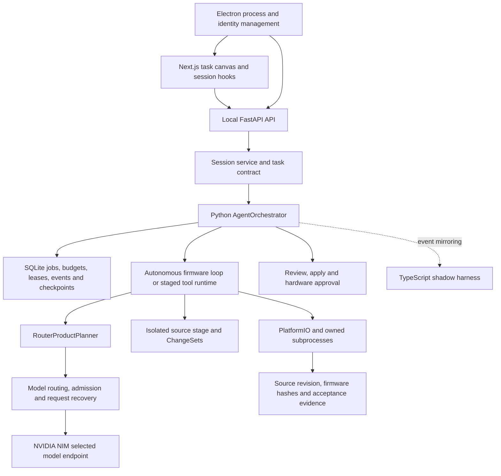

# ForgeX reliability review and fix plan

Reviewed October 1, 2026, in `D:\projects\ForgeX-Phase6-Final`.

The user's model is NVIDIA NIM `nvidia/nemotron-3-ultra-550b-a55b`.
The screenshot shows a saved Standard task with 88 tool calls, 105 model
requests, approximately four minutes, 184,320 reserved output tokens and
6.65 MB of input allowance remaining. Its blocker is
`AGENT_RESUME_CHECKPOINT_UNAVAILABLE`. This task has a recovery failure even
though its allowances have not run out.

**The first fixes should be continuation checkpoints and recovery controls,
followed by independent verification of saved drafts.** Provider availability
protection and earlier compilation should then reduce how often tasks reach
those recovery paths. Increasing limits alone does not repair the checkpoint
failure or the ineffective retry button.

This document is a review and implementation plan. The production source was
not edited during this review. The checkout already contains extensive
uncommitted implementation work; findings refer to that current source,
not just commit `0f293c540fcede4f2d3e95e74cc80b5c15f0faee`.
The reviewed backend fingerprint is
`713a69654c3932217210d6aeb58960d710fc5cee9445d67c517d70b6546079f0`.

## How the project works

ForgeX is a desktop firmware development environment. Its core workflow is
request interpretation, scoped editing in a stage, firmware compilation,
repair, requirement evidence, ChangeSet review/application and optional
approved flashing or serial observation.

| Subsystem | Files inspected and responsibility |
| --- | --- |
| Desktop lifecycle | `electron/backend-manager.ts`, `frontend-manager.ts`, `paths.ts`, `desktop-logging.ts`: startup, process ownership, runtime identity, frontend resources and logging. |
| Composition and local API | `backend/api/app.py`, dependencies, local security and routes: services, authentication, health, jobs, builds and event streams. |
| Session and task state | Session routing, contracts, context assembly and task projections: user intent, permissions, requirements, exclusions and continuation context. |
| Run authority | `backend/agent_runtime/orchestrator.py`: session lease, run graph, stage ownership, durable recovery and final settlement. |
| Model execution | `router_planner.py`, model router/runtime, provider adapters and LLM service: selected model, wire formats, bounded retries, metadata and physical request accounting. |
| Tool execution | Autonomous loop, staged tool runtime, canonical runtime, registry and capability policy: settled model attempts, ordered tools and permission enforcement. |
| Persistence | Orchestration store, jobs and checkpoint copying: journal integrity, sealed snapshots, budgets and restart recovery. |
| Firmware verification | PlatformIO service, build tool, repair code, artifact service and acceptance reports: compilation, diagnostics, freshness and firmware hashes. |
| Changes and hardware | ChangeSet service, approval/flash paths, serial and subprocess ownership: staged edits, application and hardware effects. |
| Frontend recovery | Task canvas, job controls, session hook and stream policy: saved work, buttons, budgets, evidence and replacement-run subscriptions. |
| Harness and release | Harness runtime and desktop packaging/qualification scripts: shadow event storage, packaged provenance and qualification gates. |

Python is the execution authority. The harness currently declares itself
non-authoritative. Repairing the Python continuation and verification paths is
therefore the direct intervention for these incidents.

## Verified findings

### 1. A continuation can lose recovery before its first settled turn — P0

Both runtime paths create an admission checkpoint only for an initial run:

- `backend/agent_runtime/orchestrator.py:1446`: `if not saved_checkpoint`.
- `backend/agent_runtime/tool_runtime.py:379`: `if durable and not resume_checkpoint`.

A replacement run inherits its parent's checkpoint for execution, but does
not immediately seal that carried state under its own run identity. If it
fails, is cancelled or the backend stops before the next settled turn,
`recovery_info()` looks for the replacement's checkpoint and finds none.
It returns `AGENT_RESUME_CHECKPOINT_UNAVAILABLE`.

**Reproduced locally:** a first run saved an edit and an eligible checkpoint;
resuming it created a second run; a simulated timeout before that run's first
settlement left it `paused_model_unavailable`, with no checkpoint and
`eligible: false`. The active project retained its original file contents.
The probe used isolated state and a fake executor, with no provider calls.

The saved history contains the corresponding pattern for job
`job-48f3592721e84e71ad26e7f04f961a67`: its first attempt created eight files,
used 15 physical requests and approximately 665.55 of 900 seconds; its linked
replacement has no usable checkpoint. These counters match the screenshot.
The screenshot and history strongly support this diagnosis; they do not
establish the exact timing of every interruption in the installed process.

### 2. The outage retry button can silently do nothing — P0

The orchestrator exposes `recovery_actions = ["resume"]` for transient
provider outages. The task canvas's **Retry same model** button calls
`agent.retry()` (`frontend/components/nexus/task-canvas.tsx:501`).
That hook returns immediately unless the actions contain `"retry"`
(`frontend/hooks/use-forge-agent-session.ts:756`).

This is a confirmed contract mismatch. The button may send no request and
display no error. The separate **Continue task** control is disabled for a
budget pause, but remains enabled for other blockers such as a missing
checkpoint; the API then rejects the action. These controls should derive
their enabled state and action from the server's recovery eligibility.

The **Change model** button currently opens the composer selector. Run
recovery itself still copies the old run's provider/model. Choosing a new
composer model does not provide a route for continuing the same checkpoint
with that model. An explicit switch-and-continue operation is needed.

### 3. Build evidence and the failure message can disagree — P1

At `backend/agent_runtime/orchestrator.py:1561`, verified partial completion
is allowed for a small whitelist of final-response/schema failures.
`MODEL_OUTPUT_TRUNCATED` and `PROVIDER_TIMEOUT` are outside that list.

**Reproduced locally:** with the same fake host result reporting
`build_verified: true` and `build_result.success: true`, a schema failure
produced a verified review draft, while truncation and timeout produced text
calling the draft unverified. This probe establishes the settlement/label
behavior; it does not substitute for a real firmware build.

Historical runs also contain successful build results followed by truncation
or timeout. A historical `success: true` alone does not prove that the final
source or binary is still current. The fix must preserve and check evidence
by source revision, target/environment and artifact hash, and display build,
requirements, tests and hardware evidence independently of model completion.

For the screenshot's task, no successful build result was found. Its
unverified build state is justified. Removing that label would hide missing
verification.

### 4. Provider failures can consume the useful part of a task — P1

The September 30 saved outage run returned HTTP 503, had 11 generated files
and no successful build. Its replacement stopped near the 900-second
deadline, retaining the 11 files in a draft. Another historical repair run
failed compilation and consumed its input allowance while revisiting reads
and diagnostics. These are separate failure mechanisms.

The current source already has substantial protection:

- One managed chain of at most four physical attempts per logical request,
  including output repair; transactional buffering prevents partial tools
  from being replayed.
- Durable cooldowns and a cap on automatic continuations.
- Cumulative budgets, a final time reserve, bounded process execution,
  progress guards and compiler-evidence repairs.
- Freshness checks, journal integrity, trust checks and uncertain-effect
  blocking.

Those features should be retained. They do not guarantee an early build.
The autonomous loop generally builds when the model requests a build or
declares completion; it can write many files and then lose model access
before reaching either point.

The effective timeout policy also differs from README guidance. The current
NIM request default is 120 seconds, the product planner is configured for
300 seconds, and each turn is capped to one third of remaining runtime.
The planner refuses a new turn at 45 seconds remaining. The README still
describes 45-second NIM requests and 60-second whole turns.
Late in a task, the turn allowance can be shorter than the model's normal
response latency. Fixed reserves and a 15-second retry admission margin
should be qualified against observed response and build latency.

### 5. Admission control does not coordinate an endpoint outage — P1

`ProviderAdmissionController` limits NVIDIA to one concurrent logical turn
inside a router instance. It does not keep an endpoint outage state or a
single recovery probe shared across jobs. Each job can independently reach
the unavailable model; durable retries use fixed cooldowns without jitter.

A bounded circuit breaker is a proposed improvement, rather than a claim
that a circuit breaker alone would fix the current incidents. It should
reduce futile requests and retry synchronization across jobs while leaving
saved work available for local verification.

### 6. Some API tests use repository runtime state — P0 for verification

`tests/api/test_api_routes.py:152` constructs an application with an isolated
workspace, but not every caller isolates the app's default `PathManager()`
state (`backend/api/app.py:152`). `tests/conftest.py` sets a timeout default
but does not provide a complete temporary persistence boundary.

The first test invocation in this review loaded the repository orchestration
database. Startup reconciliation changed saved run metadata and marked an
incomplete run interrupted. It was stopped once this was discovered. The
review does not claim that database was untouched. Historical creation times
and saved counters support the incident findings; startup-generated
interruption events must be distinguished from the original incident.

The complete rerun used a fresh `FORGEX_ROOT` and temporary settings path
under `.forgex/reliability-review-tests`. Add a default fixture and a test
that makes user/repository persistence inaccessible to prevent recurrence.

## Implementation order and acceptance criteria

### Change 1: isolate tests and seal every continuation before execution

1. Make test storage temporary by default, including app state, settings,
   provider storage and credentials. Explicit persistence tests use their
   own temporary paths. Verify that test startup cannot access user state.
2. Seal a checkpoint for every admitted run, including replacements, before
   the first provider request or tool effect. Carry the existing turn,
   observations, plan, task contract, staged revision and consumed budgets.
   Give the new checkpoint the replacement's identity and journal binding.
3. Order recovery publication so a run advertised as continuable has a
   validated checkpoint. Validate the crash window between replacement
   reservation, run publication, admission and recovery-link completion.
4. For existing stranded jobs, inspect the sealed parent checkpoint and
   lineage. If the child has no settled effects and all workspace/stage,
   journal and operation checks pass, offer recovery from the validated
   saved state with an explicit record of its origin. Otherwise offer a
   fresh attempt based on the reviewed draft, with fresh evidence collection.
   Preserve the historical records and cumulative budgets.

**Required regressions:** failure before the first continuation settlement,
restart at every admission boundary, repeated outages through all permitted
recoveries, duplicate resume requests, changed stages/workspaces, corrupt
seals and unknown apply/flash outcomes. Cover both runtime paths. All safe
cases must retain a usable checkpoint; uncertain effects remain blocked.

### Change 2: make recovery controls agree with the backend

1. Give outage continuation one canonical action. Route **Retry same model**
   through the eligible checkpoint/job resume path; prevent silent no-ops.
2. Return recovery eligibility with the job projection. Disable an
   unavailable action and show the exact next action: wait, add budget,
   inspect uncertain effects, recover a saved draft, or choose a model.
3. Keep button requests single-flight and idempotent, and follow the current
   replacement run even when the screen is showing an older attempt.
4. Add an explicit **Continue saved work with selected model** path. Validate
   the configured selection and existing disclosure policy; keep the source,
   task contract, budgets and lineage, and record the chosen provider/model.
   Selecting a composer model and continuing saved work should have an
   explicit, visible relationship.

**Required browser regressions:** the exact screenshot state; a paused run
with only `resume`; blocked checkpoint; budget pause; scheduled cooldown;
double click; successful continuation; and explicit model change preserving
the draft. Assert the actual API request and replacement identity.

### Change 3: verify saved work without needing another model response

1. Persist separate evidence states for source requirements, firmware build,
   requested tests/simulation and hardware. Tie each to current source,
   target/environment and artifact identity.
2. Add a host-owned **Verify saved draft** operation under the existing
   project trust and build permissions. Compile the validated stage and
   record diagnostics even when NVIDIA is unavailable. It must not require
   generating another tool plan to start the build.
3. If compilation succeeds, show **build verified** while any missing
   requirement, test or hardware evidence remains pending. If compilation
   fails, preserve actionable compiler diagnostics for a later repair.
   Label acceptance criteria as requirements and display their observed
   evidence separately: the screenshot currently places statements such as
   "A firmware build passes" next to an unverified result, which can read as
   a contradictory claim.
4. Finalize task completion from host evidence and the task's acceptance
   requirements. Use a deterministic result message if a final model summary
   fails. An optional summary should not invalidate a current build.
5. Invalidate evidence after source or binary changes; verify the same
   boundaries again before application or hardware preparation.

**Required regressions:** timeout/truncation after a successful current build;
outage before any build; edits after build; binary tampering; environment
mismatch; missing requested tests; incomplete requirements; and offline
draft compilation with zero model requests.

### Change 4: schedule earlier builds and protect useful runtime

1. Add host-visible compile milestones: build an appropriate project skeleton,
   compile after meaningful implementation batches, and repair small groups
   of diagnostics before expanding the project further.
2. Reserve enough time for the next build/test and durable settlement using
   measured warm/cold toolchain costs. Provision toolchains outside a model
   repair cycle when possible and expose that work separately.
3. Measure provider queue time, request time, backoff, build time and active
   tool time separately. Keep cumulative limits and a bounded overall task
   lifetime. Durable cooldown time between attempts must not be confused
   with active request time.
4. Admit a model attempt only when the remaining budget can cover a useful
   response and required validation. Pause with an explicit continuation
   requirement when that is impossible. Do not automatically inflate budgets.
5. Retain compact diagnostic context and progress guards; ensure repeated
   reads or unchanged failed builds do not keep postponing compilation.
6. Update README and UI guidance to describe the effective timeout policy
   from the same source as runtime configuration.

**Required regressions:** slow but successful Nemotron turns; repeated fast
503s; a cold PlatformIO build; late-turn admission; complex multi-file work;
no-progress repair; and restart preserving every consumed allowance.

### Change 5: contain provider outages and qualify the installed artifact

1. Add endpoint/model health coordination with closed/open/probe states,
   bounded cooldowns, jitter and one recovery probe. Scope health to the
   configured endpoint/model and credential identity without persisting keys.
2. Honor `Retry-After` in request and durable scheduling. Bound both physical
   attempts and continuations. Keep the selected model until an explicit
   selection changes it.
3. Record one failure identity per physical request: endpoint origin, current
   HTTP status, provider request ID, retry decision, latency and deadline.
   Avoid presenting a previous successful response's HTTP 200 as the status
   of a later timeout; distinguish timeouts before and after response headers.
4. Package the reviewed source and expose its fingerprint in diagnostics.
   Reproduce the outage/recovery drill against that exact packaged backend.
   Editing this checkout does not update a running or installed desktop.
5. Use the existing real-provider qualification runners for the selected NIM
   model, the recorded complex prompts and follow-up edits. Record completion,
   recovery, time to first build, failed physical requests, source freshness
   and human requirement review. Keep provider outages distinguishable from
   internal recovery failures in the results.

**Required drills:** 503 followed by recovery; prolonged unavailability;
429 with a long Retry-After; timeout before and after streamed data; broken
stream; outage immediately after resume; backend stop/restart; offline local
draft verification; and explicit model transfer. No interrupted tool effect
may be executed twice. Hardware effects require their existing approvals.

## What a durable outcome should look like

For a recoverable NVIDIA outage, the app should show the endpoint failure,
an intact draft, current verification evidence, a valid saved checkpoint and
a working next action. It should support local compilation of that draft.
When NVIDIA recovers, continuation should start from settled work with
remaining allowances. When allowances or safety evidence prevent continuation,
the UI should show the specific blocker and the action that resolves it.

A permanent product fix can guarantee these ForgeX behaviors under defined
fault scenarios. It cannot guarantee that an external endpoint will always
answer or that every generated program compiles. A build genuinely lacking
evidence should continue to be shown as unverified.

## Verification completed during this review

| Check | Result |
| --- | --- |
| Isolated full Python suite | 2,075 passed; four Windows symlink skips; two dependency deprecation warnings; 301.62 seconds. |
| Frontend UI state tests | 71 passed. |
| Electron tests and TypeScript build | 38 passed. |
| Harness tests and TypeScript build | 11 passed. |
| Release script tests | 26 passed. |
| Frontend TypeScript check | Passed. |
| Frontend lint with zero warnings allowed | Passed. |
| Continuation checkpoint reproduction | Confirmed: replacement failed before first settlement has no checkpoint and is ineligible. |
| Verification label reproduction | Confirmed: truncation/timeout report unverified despite the injected host result's verified build. |

The probe scripts and isolated data are retained locally under `.forgex`:
`reliability-review-inspect.py`, `reliability-review-reproduce.py` and
`reliability-review-probes/`. They are review aids, not production code.

Passing the existing suite does not cover the newly reproduced boundary
cases. The next implementation must add those regressions before treating
the incidents as fixed.

The default local backend port 8000 was not listening when checked. The
installed process and its source fingerprint therefore were not verified.
This review did not perform live model requests, new firmware compilation,
physical flashing, the 90-attempt provider campaign, a new frontend production
build or browser execution. Existing documentation of those checks is prior
evidence, not a result from this review.

## Implementation follow-up

The recovery, independent draft verification, early build, deadline, endpoint
cooldown and test isolation changes have now been implemented. See
[implementation and validation results](reliability-fixes-2026-10-01.md).
The review findings and original test results above are retained as the baseline.

## External references

- [NVIDIA's selected model API](https://docs.api.nvidia.com/nim/reference/nvidia-nemotron-3-ultra-550b-a55b-infer)
  documents the exact model identifier and chat-completions endpoint; its
  existence does not establish the endpoint's availability during an incident.
- [HTTP semantics, RFC 9110](https://www.rfc-editor.org/rfc/rfc9110.html#section-15.6.4)
  defines 503 as inability to handle a request associated with temporary
  overload or maintenance and permits a Retry-After hint. The saved ForgeX
  status cannot identify NVIDIA's internal cause more specifically.
- [AWS retry with backoff guidance](https://docs.aws.amazon.com/prescriptive-guidance/latest/cloud-design-patterns/retry-backoff.html)
  supports bounded backoff and idempotency considerations. The endpoint
  coordination and verification separation above are recommendations based
  on the reviewed ForgeX paths and reproductions.
